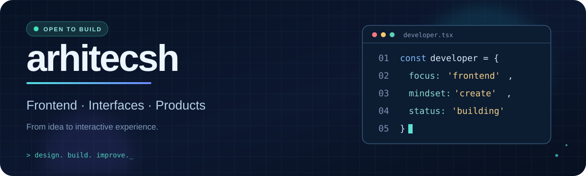

<div align="center">



<br/>

<a href="https://github.com/arhitecsh?tab=followers"></a>
<a href="https://github.com/arhitecsh?tab=repositories"></a>

### Привет! Я `arhitecsh` 👋

*Создаю интерфейсы, экспериментирую с технологиями и превращаю идеи в работающие проекты.*


</div>

---

## ✦ Обо мне

Люблю понятные интерфейсы, продуманные детали и проекты, в которых дизайн помогает решать реальные задачи. Развиваюсь в веб-разработке: от HTML/CSS и JavaScript до компонентных приложений на React и TypeScript. Учусь на практике, собираю прототипы и улучшаю их шаг за шагом.

```typescript
const arhitecsh = {
  interests: ["Frontend", "UI/UX", "Web apps"],
  approach: "Make it clear. Make it useful. Make it beautiful.",
  currently: "Building and learning",
};
```

## ⚡ Мой стек

<div align="center">


</div>

<sub>Часть инструментов использую в проектах, часть продолжаю изучать.</sub>

## 🚀 Избранные проекты

<table>
<tr>
<td width="50%" valign="top">

### 🗂️ [Мой портфель](https://github.com/arhitecsh/VK-MAX)

Интерактивный прототип мини-приложения для школьников: задачи, расписание и важная учебная информация в одном интерфейсе.

`React` · `TypeScript` · `Vite` · `UX`

<a href="https://github.com/arhitecsh/VK-MAX">Посмотреть проект →</a>

</td>
<td width="50%" valign="top">

### 🧭 [Belle Route](https://github.com/arhitecsh/belle-route)

Адаптивный туристический лендинг с выпадающим меню, слайдером предложений и плавными анимациями.

`HTML` · `CSS` · `JavaScript` · `Swiper`

<a href="https://github.com/arhitecsh/belle-route">Посмотреть проект →</a>

</td>
</tr>
<tr>
<td width="50%" valign="top">

### ☁️ [Cloud Flex](https://github.com/arhitecsh/cloud-flex)

Экспериментальный проект по разработке лендинга и визуальной композиции веб-страницы.

`Web` · `Landing page`

<a href="https://github.com/arhitecsh/cloud-flex">Посмотреть проект →</a>

</td>
<td width="50%" valign="top">

### 🔎 [GitHub User Search](https://github.com/arhitecsh/github-user-search)

Учебный проект, посвящённый поиску пользователей GitHub.

`Practice` · `Web development`

<a href="https://github.com/arhitecsh/github-user-search">Посмотреть проект →</a>

</td>
</tr>
</table>

## 📊 GitHub activity

<div align="center">


<br/>


</div>

## 🌱 Что дальше

- Создавать более быстрые, удобные и выразительные интерфейсы.
- Развивать практические навыки React, TypeScript и современного веб-стека.
- Делать проекты, которые приятно не только смотреть, но и использовать.

---

<div align="center">

### Спасибо, что заглянули! ✨

**Good code is useful. Great code is thoughtful.**

<a href="https://github.com/arhitecsh"></a>

<sub>Designed with care · 2026</sub>

</div>
